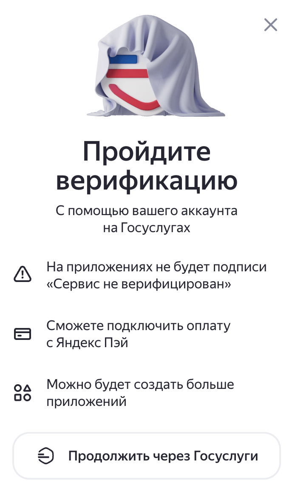
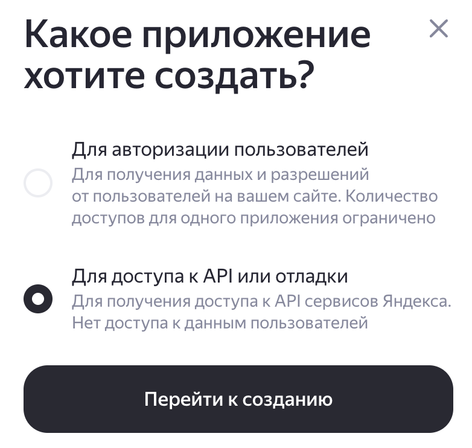
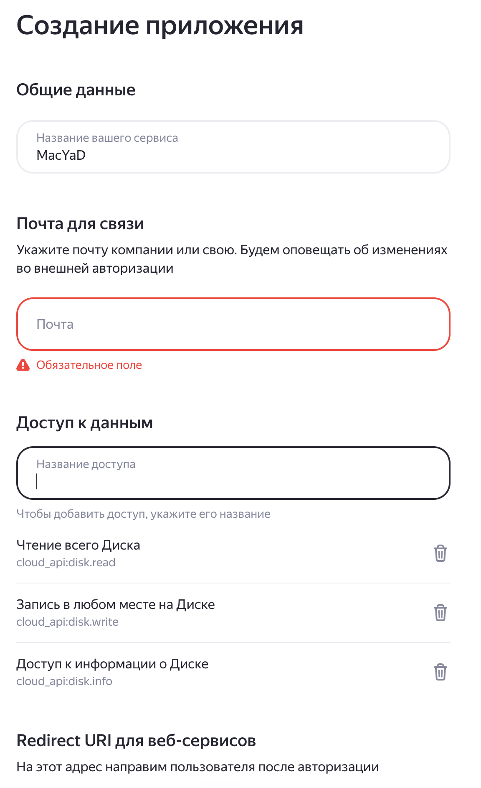
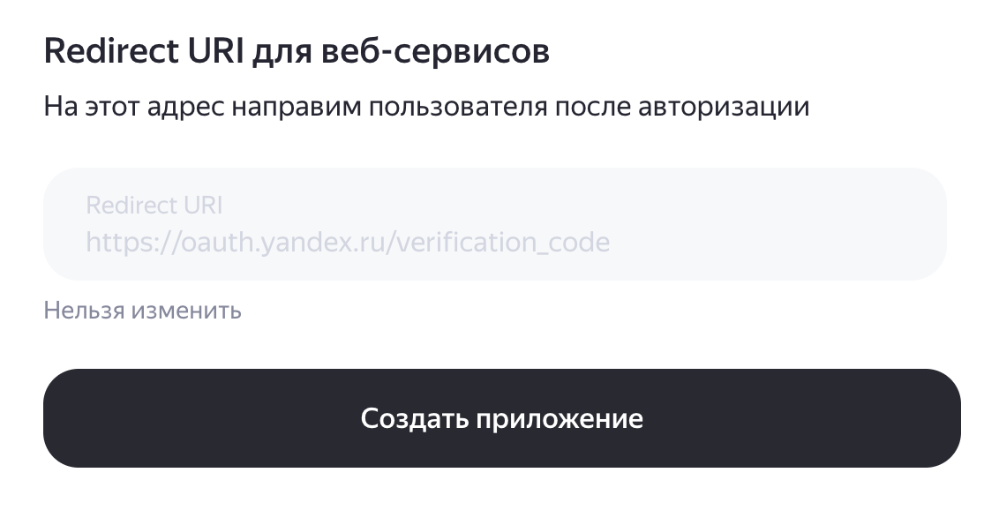
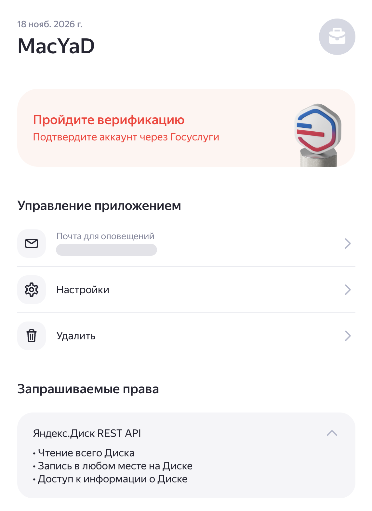
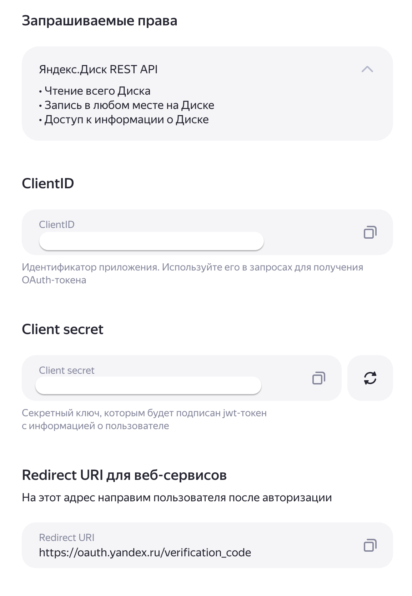

[English](yandex-oauth-app.md) | [Русский](yandex-oauth-app.ru.md)

# Connect Yandex Disk through your own OAuth app

*Required for every account since October 2026. Takes about five minutes.*

## What happened

Since October 2026 Yandex no longer lets rclone's built-in OAuth app touch files. The remote still looks connected — `rclone about` reports the disk size — but every listing, upload or download fails:

```
ERROR : error listing: [410 - GoneError] Gone (Ресурс больше недоступен.)
```

In MacYaD this shows up as `Push to Yandex blocked` / `Check Yandex` failures with `410 - GoneError` in the journal. Logging in again with `rclone config reconnect` or `rclone config create … yandex` does not help: both go through the same blocked app. MacYaD versions before the fix also offered exactly these commands. Yandex has not announced the change; it is tracked in [rclone issue #10067](https://github.com/rclone/rclone/issues/10067).

The fix is to register your own OAuth app in Yandex (free, under your own account) and give its credentials to rclone. rclone then gets and refreshes tokens through your app, not through the blocked one.

## 1. Create the app

Open [oauth.yandex.ru/client/new](https://oauth.yandex.ru/client/new/) under the Yandex account whose Disk you sync.

**Skip the verification prompt.** Yandex offers to verify the account through Gosuslugi. It is not needed for this: close the dialog with ×. Without it the consent page will say the service is not verified — that is your own app, so it is fine.



**Choose «Для доступа к API или отладки»** (*For API access or debugging*) and press «Перейти к созданию».



**Fill in the form:**

- «Название вашего сервиса» (*service name*) — anything, for example `MacYaD`.
- «Почта для связи» (*contact email*) — your email; Yandex writes here about changes to its OAuth.
- «Доступ к данным» (*data access*) — start typing a permission name into the field and add these three:
  - «Чтение всего Диска» — `cloud_api:disk.read`
  - «Запись в любом месте на Диске» — `cloud_api:disk.write`
  - «Доступ к информации о Диске» — `cloud_api:disk.info`



**Leave the redirect URI as it is.** For this app type it is fixed to `https://oauth.yandex.ru/verification_code` and cannot be changed. That is why `rclone config` cannot finish the login by itself here, and why step 2 uses a script. Press «Создать приложение».



The app page opens. Check that the permissions list shows the three Disk entries.



Further down are **ClientID** and **Client secret** — you will paste them in the next step. Treat the secret like a password: do not publish it or commit it anywhere.



## 2. Connect the remote

In MacYaD, copy the command from the onboarding step «Connect Yandex Disk through your own OAuth app» or from «Reconnect account» in Settings → Yandex accounts, and run it in Terminal. It looks like this:

```bash
python3 '/Applications/MacYaD.app/Contents/Resources/connect_yandex.py' --config '…/MacYaD/rclone/rclone.conf' --remote macyad-yandex
```

From a clone of this repository the same script is `./script/connect_yandex.py`.

The script:

1. asks for **ClientID** and **Client secret** (input is hidden, nothing lands in shell history);
2. opens the Yandex consent page in your browser — press «Разрешить» (*Allow*);
3. asks for the confirmation code Yandex shows after that. The code is valid for about 10 minutes, so paste it right away;
4. exchanges the code for a token and writes `client_id`, `client_secret` and the token into the `macyad-yandex` remote in `~/Library/Application Support/MacYaD/rclone/rclone.conf`.

If your remote has another name or lives in another config, pass `--remote NAME` and `--config PATH`. The script needs only the `python3` that comes with the Xcode Command Line Tools, which Homebrew installs anyway.

Check the result:

```bash
rclone --config "$HOME/Library/Application Support/MacYaD/rclone/rclone.conf" lsd macyad-yandex:/
```

You should see your top-level folders instead of `410 - GoneError`. Then run `Check Yandex` on any pair in MacYaD.

## What next

- **The token refreshes itself.** It is valid for about a year, and rclone renews it through your app before it expires. No need to refresh it by hand.
- **To log in again**, use «Reconnect account» in MacYaD Settings: it copies the same script command. Plain `rclone config reconnect` will not work — it waits for a browser redirect to `127.0.0.1`, and this app type only redirects to `oauth.yandex.ru/verification_code`.
- **Several Yandex accounts** — create a separate app under each account and run the script with `--remote` for the matching remote.

## If something goes wrong

| What you see | Meaning | What to do |
|---|---|---|
| `410 - GoneError` after the script | the remote still uses rclone's built-in app | make sure `--remote` names the remote MacYaD uses (Settings → Yandex accounts) and run the script again |
| `Yandex refused the code: HTTP 400 Invalid code` | the code expired or was already used, or ClientID or secret was mistyped | copy ClientID and secret again with the copy buttons on the app page, run the script and use a fresh code |
