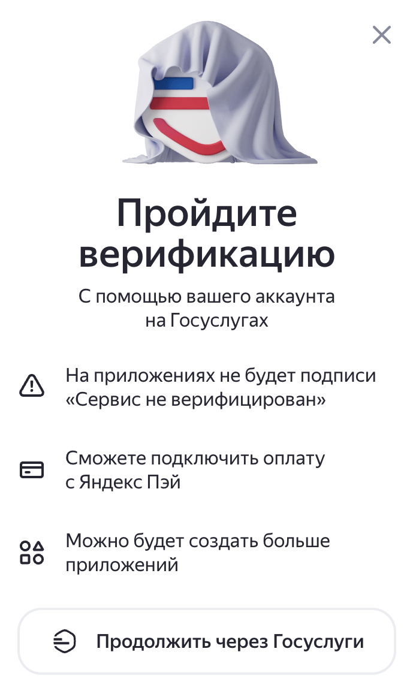
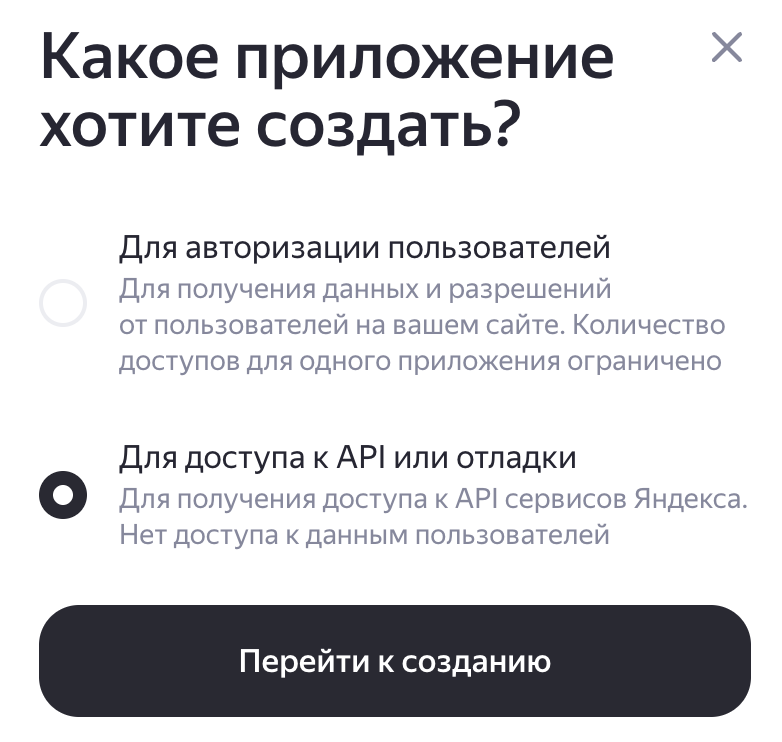
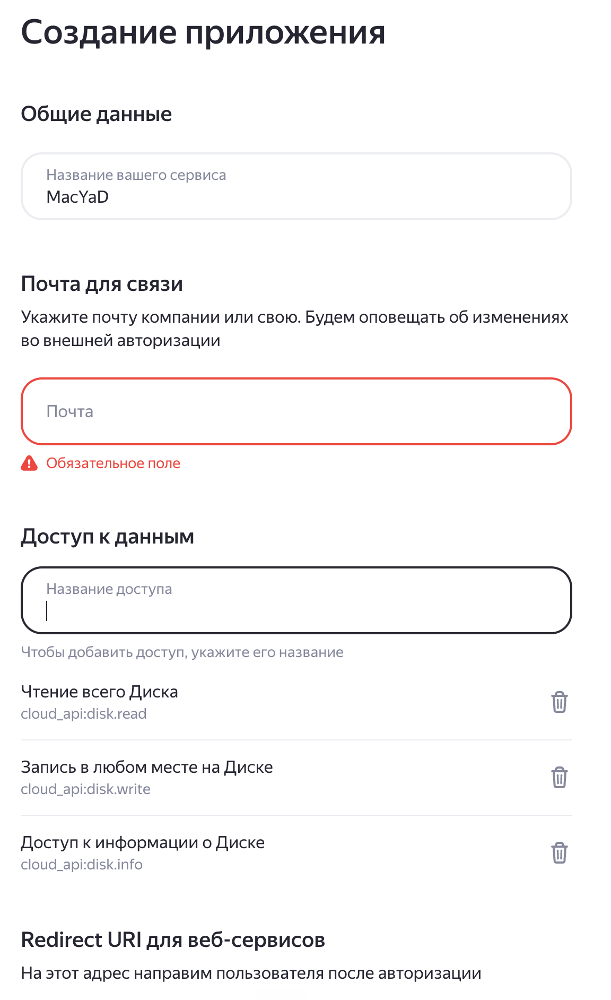
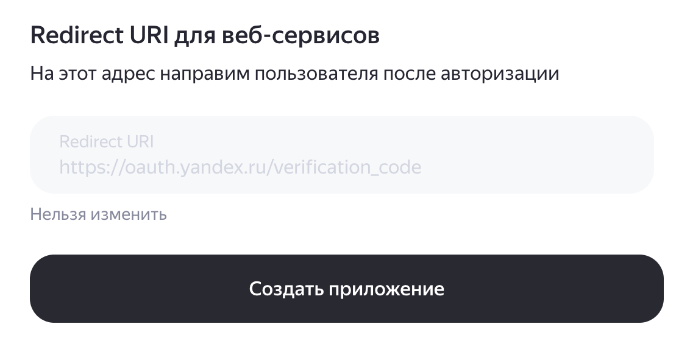
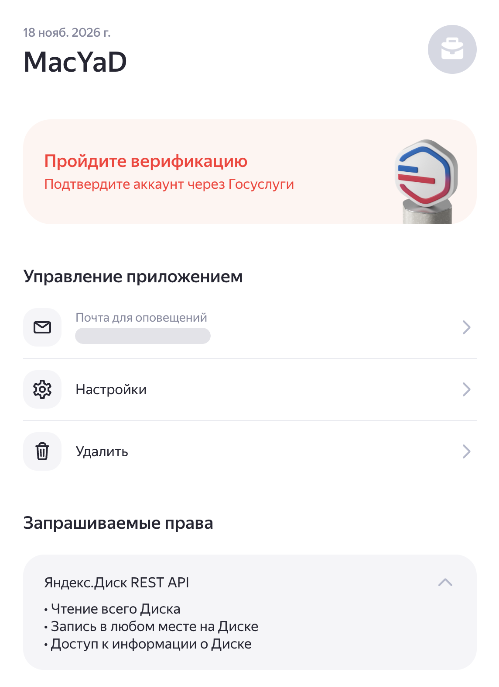
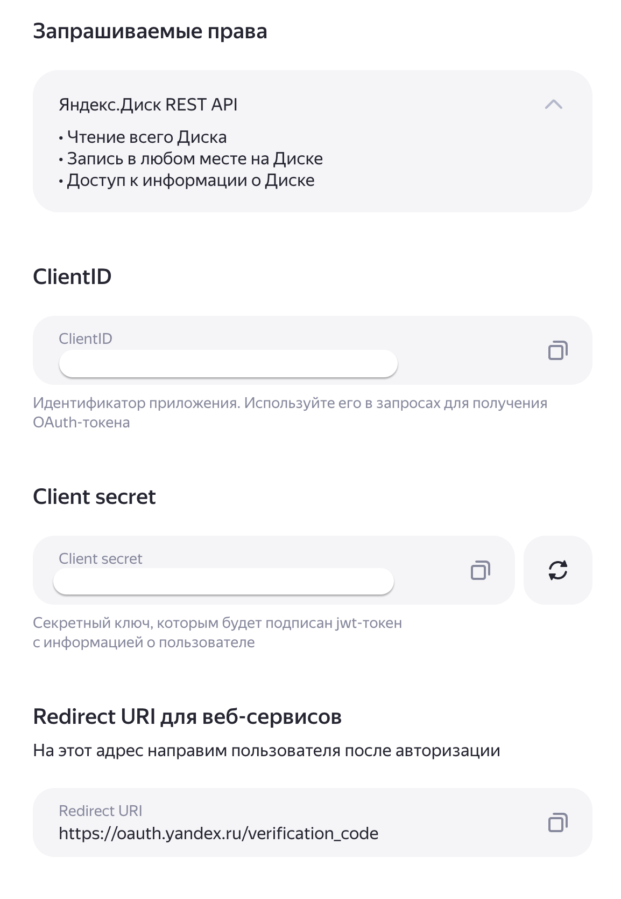

[English](yandex-oauth-app.md) | [Русский](yandex-oauth-app.ru.md)

# Подключение Яндекс Диска через своё OAuth-приложение

*Нужно для каждого аккаунта с октября 2026 года. Займёт около пяти минут.*

## Что случилось

С октября 2026 года Яндекс блокирует доступ к файлам встроенному OAuth-приложению rclone. Remote выглядит подключённым — `rclone about` показывает объём диска, — но любой листинг, загрузка или скачивание падает:

```
ERROR : error listing: [410 - GoneError] Gone (Ресурс больше недоступен.)
```

В MacYaD это видно как `Push to Yandex blocked` или сбой `Check Yandex` с `410 - GoneError` в журнале. Повторный вход через `rclone config reconnect` или `rclone config create … yandex` не помогает: обе команды идут через то же заблокированное приложение. Версии MacYaD до исправления предлагали именно их. Яндекс об изменении не объявлял, проблема описана в [issue rclone #10067](https://github.com/rclone/rclone/issues/10067).

Решение — зарегистрировать в Яндексе своё OAuth-приложение (бесплатно, в своём аккаунте) и передать его ключи rclone. Тогда rclone получает и продлевает токены через ваше приложение, а не через заблокированное.

## 1. Создайте приложение

Откройте [oauth.yandex.ru/client/new](https://oauth.yandex.ru/client/new/) под тем аккаунтом Яндекса, чей Диск синхронизируете.

**Пропустите верификацию.** Яндекс предложит подтвердить аккаунт через Госуслуги. Для этой задачи она не нужна: закройте окно крестиком. Без верификации на странице разрешения будет надпись «Сервис не верифицирован» — это ваше собственное приложение, так и должно быть.



**Выберите «Для доступа к API или отладки»** и нажмите «Перейти к созданию».



**Заполните форму:**

- «Название вашего сервиса» — любое, например `MacYaD`.
- «Почта для связи» — ваша почта, сюда Яндекс пишет об изменениях в OAuth.
- «Доступ к данным» — начните вводить название в поле и добавьте три доступа:
  - «Чтение всего Диска» — `cloud_api:disk.read`
  - «Запись в любом месте на Диске» — `cloud_api:disk.write`
  - «Доступ к информации о Диске» — `cloud_api:disk.info`



**Redirect URI не меняйте.** У этого типа приложения он зафиксирован: `https://oauth.yandex.ru/verification_code`. Из-за этого `rclone config` не сможет завершить вход, и на шаге 2 нужен скрипт. Нажмите «Создать приложение».



Откроется страница приложения. Проверьте, что в запрашиваемых правах три пункта Диска.



Ниже — **ClientID** и **Client secret**, они понадобятся на следующем шаге. Относитесь к секрету как к паролю: не публикуйте его и не добавляйте в репозиторий.



## 2. Подключите remote

В MacYaD скопируйте команду из шага онбординга «Подключить Яндекс Диск через своё OAuth-приложение» или из «Reconnect account» в Settings → Yandex accounts и выполните её в Терминале. Она выглядит так:

```bash
python3 '/Applications/MacYaD.app/Contents/Resources/connect_yandex.py' --config '…/MacYaD/rclone/rclone.conf' --remote macyad-yandex
```

В клоне репозитория тот же скрипт — `./script/connect_yandex.py`.

Скрипт:

1. спросит **ClientID** и **Client secret** — ввод скрыт, в историю оболочки ничего не попадёт;
2. откроет в браузере страницу разрешения Яндекса — нажмите «Разрешить»;
3. спросит код подтверждения, который Яндекс покажет после этого. Код действует около 10 минут, вставьте его сразу;
4. обменяет код на токен и запишет `client_id`, `client_secret` и токен в remote `macyad-yandex` в файле `~/Library/Application Support/MacYaD/rclone/rclone.conf`.

Если remote называется иначе или лежит в другом конфиге, передайте `--remote ИМЯ` и `--config ПУТЬ`. Скрипту нужен только `python3` из Xcode Command Line Tools — их всё равно ставит Homebrew.

Проверьте результат:

```bash
rclone --config "$HOME/Library/Application Support/MacYaD/rclone/rclone.conf" lsd macyad-yandex:/
```

Вместо `410 - GoneError` должны появиться папки верхнего уровня. Затем запустите `Check Yandex` на любой паре в MacYaD.

## Что дальше

- **Токен продлевается сам.** Он действует около года, и rclone обновляет его через ваше приложение. Обновлять его вручную не нужно.
- **Чтобы войти заново**, используйте «Reconnect account» в настройках MacYaD: кнопка копирует ту же команду скрипта. Обычный `rclone config reconnect` не сработает: он ждёт возврата браузера на `127.0.0.1`, а приложение этого типа возвращает только на `oauth.yandex.ru/verification_code`.
- **Несколько аккаунтов Яндекса** — заведите отдельное приложение под каждым аккаунтом и запускайте скрипт с `--remote` для соответствующего remote.

## Если что-то пошло не так

| Что видно | Что это значит | Что делать |
|---|---|---|
| `410 - GoneError` после скрипта | remote всё ещё использует встроенное приложение rclone | проверьте, что `--remote` — тот remote, который использует MacYaD (Settings → Yandex accounts), и запустите скрипт ещё раз |
| `Yandex refused the code: HTTP 400 Invalid code` | код истёк или уже использован, либо ClientID или секрет введены с ошибкой | скопируйте ClientID и секрет заново кнопками на странице приложения, запустите скрипт и введите свежий код |
